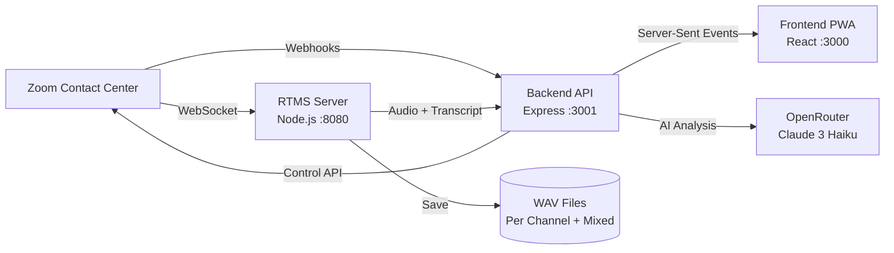

---
# ── Required — validation fails without these ───────────────────────────────
title: "Remote Access for Contact Center Engagements"
slug: "engagement-remote-access"
description: >-
  Gain remote access to real-time engagement streams to monitor agent activity and control media streams. Capture live audio and transcripts from Zoom Contact Center voice engagements with AI-powered insights and coaching analytics.
products: ["rtms", "contact-center"]
verticals: ["customer-support"]
estimated_time: "2-4 hours"
author: "Rehema Armorer"
status: "draft"
updated: 2026-09-02

# ── Strongly encouraged — the site hides blueprints without a repo ──────────
github_repo: "https://github.com/zoom/zcc-rtms-PWA_sample-js"
demo_url: "https://youtu.be/cQ5eT_UbMIY?si=7TwtTTzF0EHwJOCi"

# ── Optional — delete what you don't use ────────────────────────────────────
solution_types: ["transcription-summarization", "analytics"]
tags: ["real-time", "rtms", "contact-center", "ai-coaching", "audio-capture"]
seo_title: "Real-Time Contact Center Engagement Monitoring with Zoom RTMS"
seo_keywords: ["zoom contact center rtms", "real-time media streams", "contact center monitoring", "ai coaching analytics"]
license_required: true
license_note: "Requires RTMS add-on license for Zoom Contact Center"
stack: "Node.js · React · Express · WebSocket · OpenRouter · ffmpeg"
---

In contact center and customer support environments, calls and engagements are typically reviewed after they've finished. But what if you could gain insight into an engagement *while* it's in progress? Instead of attempting to connect the dots of a created summary, you could catch the pauses, questions, and events of the conversation in real time. 

This application creates an engagement analysis system that gives remote access to engagements as they're happening for live monitoring or quick drop-ins. More than that, it uses the media streams captured from the engagement to create AI-powered analytics, summaries, and next steps for admin-agent coaching. 

**What you'll need:**

- Zoom Contact Center license with admin privelages 
- Audio and transcript access via Zoom Contact Center RTMS 
- A backend to receive webhooks 
- An RTMS media processor to handle WebSocket connections and audio encoding (Node.js in this guide)
- A frontend dashboard for admins to control capture (React PWA in this guide)
- ffmpeg for audio file conversion
- An LLM for hold reason analysis (OpenRouter with Claude 3 Haiku in this guide; OpenAI, Anthropic, or self-hosted also work)

**Features:**

- **Remote RTMS control**: Admin-initiated Start/Stop controls from the browser PWA for active engagements
- **Real-time audio playback**: Live audio streamed to browser via Server-Sent Events with sub-200ms latency
- **Real-time transcript**: Live scrolling transcript display updated in real time
- **AI hold reason generation**: AI-generated reason for call hold based on 10 seconds of transcript prefacing the action
- **Engagement Snapshot page**: Post-call summary with call statistics, AI-generated narrative summary, coaching notes, and timestamped event timeline
- **Event tracking**: Real-time counters for transfer, conference, and BMW (Barge/Monitor/Whisper) events
- **Hold tracking**: Live hold time display with total hold count and cumulative hold duration

Follow along as we walk through the architecture.

## Architecture

The application operates as three independent Node.js processes that communicate via HTTP APIs and Server-Sent Events:

### Components
| Component | Responsibility | Stack |
|-----------|----------------|-------|
| **RTMS Server** | Connect to Zoom WebSocket servers, receive audio frames and transcripts, save raw PCM to disk, convert to WAV files, forward live data to backend | Node.js (ES modules) + `ws` + `ffmpeg` + `express` |
| **Backend API** | Handle OAuth 2.0 flow, receive Zoom webhooks, control RTMS start/stop, relay audio via SSE, generate AI hold reasons, track engagement events, serve frontend | Node.js (CommonJS) + Express + `axios` + OpenRouter API |
| **Frontend PWA** | Display live dashboard with RTMS controls, play audio via Web Audio API, show real-time transcript, render post-call engagement snapshots with coaching analytics | React + Zoom Apps SDK + EventSource + Web Audio API |


**Engagement flow:**

1. Zoom fires `contact_center.engagement_started` webhook to the backend, which enables the Start/Stop buttons in the PWA
2. Agent clicks "Start RTMS" in the frontend, which calls the backend API
3. Backend invokes Zoom's RTMS control endpoint
4. Zoom responds with `contact_center.voice_rtms_started` webhook containing signaling server URL, engagement ID, and stream ID
5. Backend forwards this to the RTMS server
6. RTMS server generates an HMAC-SHA256 signature using client credentials and establishes a WebSocket connection to Zoom's signaling server
7. After handshake, Zoom provides a media server URL where the RTMS server opens a second WebSocket
8. RTMS server negotiates audio format (16kHz mono L16) and transcript preferences
9. RTMS server receives real-time audio frames and transcript messages

**Audio processing:**

- Audio is saved to per-channel raw PCM files
- Audio is forwarded as base64 to the backend for SSE broadcast to browsers
- Audio is converted to WAV on engagement end

**Transcript processing:**

- Transcripts are appended to rolling buffers and files
- Transcripts are forwarded to the backend for polling
- Transcripts are used for AI hold reason generation when hold events occur



## Implementation Guide

This guide walks through building the three core services and their integration points: the backend (OAuth and webhook processing), the RTMS server (WebSocket media connections and audio capture), and the frontend (live audio playback and admin controls). Each section references actual code from the repository to demonstrate authentication, WebSocket handling, audio processing, and AI integration patterns.

### Project Structure

The monorepo contains three independent Node.js applications with a shared `.env` file:

```
rtms-zcc-pwa/
├── backend/              # Express API server (port 3001)
│   ├── server.js        # Main server with OAuth, webhooks, SSE
│   ├── controllers/
│   │   └── zoomController.js  # RTMS control logic
│   ├── helpers/
│   │   ├── zoom-api.js       # Authenticated Zoom API client
│   │   └── token-store.js    # In-memory OAuth token storage
│   └── middleware/
│       └── security.js       # Security headers
├── rtms/                # RTMS media processor (port 8080)
│   ├── server.js        # WebSocket client for Zoom RTMS
│   └── audioHelper.js   # WAV file generation and audio processing
├── frontend/            # React PWA (port 3000)
│   └── src/
│       ├── App.js              # Router with Dashboard and Snapshot pages
│       ├── pages/
│       │   ├── DashboardPage.js   # Main control panel
│       │   └── SnapshotPage.js    # Post-call analytics
│       └── hooks/
│           ├── useEngagement.js   # Active engagement polling
│           ├── useRtms.js         # RTMS control + live audio
│           ├── useTranscript.js   # Transcript polling
│           └── useHoldData.js     # Hold tracking
└── .env                 # Shared environment configuration
```

### 1. Backend: OAuth and Webhook Processing

The backend handles two critical authentication flows: the OAuth 2.0 authorization code exchange that grants API access, and webhook signature validation that ensures events actually come from Zoom. Both use HMAC-SHA256 cryptography and must handle timing attacks and replay attacks.

#### OAuth token exchange

**Input:** Authorization code from OAuth redirect, client ID, client secret, redirect URI

**Output:** Access token and refresh token stored in memory, user redirected to frontend

**Invariants:**

- Exchange code within 5 minutes of redirect (codes expire)
- Store both access token and refresh token for automatic renewal
- Use Basic Auth header with client credentials for token exchange
- Redirect to frontend URL after successful exchange

**Implementation:**
```javascript
// backend/server.js (lines 100-130 approx)
app.get('/api/auth/callback', async (req, res) => {
  const { code } = req.query;
  
  if (!code) {
    return res.status(400).send('Missing authorization code');
  }

  try {
    const tokenResponse = await axios.post('https://zoom.us/oauth/token', 
      new URLSearchParams({
        grant_type: 'authorization_code',
        code,
        redirect_uri: process.env.ZOOM_REDIRECT_URL
      }), {
        headers: { 'Content-Type': 'application/x-www-form-urlencoded' },
        auth: {
          username: process.env.ZOOM_APP_CLIENT_ID,
          password: process.env.ZOOM_APP_CLIENT_SECRET
        }
      });

    await setTokens(tokenResponse.data.access_token, tokenResponse.data.refresh_token);
    
    // Redirect to frontend
    res.redirect(process.env.FRONTEND_URL || 'http://localhost:3000');
  } catch (error) {
    console.error('OAuth error:', error.response?.data || error.message);
    res.status(500).send('Authentication failed');
  }
});
```


### 2. RTMS Server: WebSocket Media Connections

RTMS uses a two-stage WebSocket handshake: first authenticate with a signaling server using HMAC credentials, then connect to a media server to receive audio frames and transcript messages. Each engagement requires fresh connections that must be cleaned up when the call ends.

#### Signaling WebSocket authentication

**Input:** `contact_center.voice_rtms_started` webhook payload with `engagement_id`, `rtms_stream_id`, `signaling_server_url`, client ID, and client secret

**Output:** Authenticated WebSocket connection to signaling server, media server URL received in handshake response

**Invariants:**

- Generate HMAC-SHA256 signature using `${CLIENT_ID},${engagement_id},${rtms_stream_id}` as message
- Send handshake message immediately on WebSocket open (msg_type: 1)
- Wait for msg_type: 2 response before connecting to media server
- Store WebSocket reference for cleanup on engagement end

**Implementation:**
```javascript
// rtms/server.js (lines 68-96)
function generateSignature(engagementId, rtmsStreamId) {
  const message = `${CLIENT_ID},${engagementId},${rtmsStreamId}`;
  return crypto
    .createHmac('sha256', CLIENT_SECRET)
    .update(message)
    .digest('hex');
}

function connectToSignalingWebSocket(engagementId, rtmsStreamId, serverUrl, engagementData) {
  const ws = new WebSocket(serverUrl);
  engagementData.signalingWs = ws;

  ws.on('open', () => {
    const handshake = {
      msg_type: 1,
      protocol_version: 1,
      engagement_id: engagementId,
      rtms_stream_id: rtmsStreamId,
      sequence: 0,
      signature: generateSignature(engagementId, rtmsStreamId)
    };
    
    ws.send(JSON.stringify(handshake));
  });

  ws.on('message', (data) => {
    const message = JSON.parse(data.toString());
    
    if (message.msg_type === 2) {
      // Signaling ACK with media server URL
      const mediaServerUrl = message.media_server_url;
      connectToMediaWebSocket(engagementId, mediaServerUrl, engagementData);
    }
  });
}
```
#### Manual RTMS start and stop control

RTMS capture is agent-initiated, not automatic, and triggered when the respective buttons are clicked by the user, tied to this event. 

**Input:** Engagement ID, action ("start" or "stop"), OAuth access token

**Output:** RTMS state updated in Zoom, `contact_center.voice_rtms_started` or `contact_center.voice_rtms_stopped` webhook fired

**Invariants:**

- Only call RTMS control when engagement is active (frontend checks `isActive` state)
- Include `client_id` in settings object (Zoom uses this to route RTMS data)
- Handle 401 responses by refreshing OAuth token and retrying
- Wait for webhook confirmation before attempting WebSocket connection
- Close existing WebSocket connections before starting new RTMS session for same engagement

**Control flow:**

1. Agent clicks "Start RTMS" or "Stop RTMS" button in frontend PWA
2. Frontend sends POST to backend `/api/zoom/rtms/control` with the engagment ID and appropiate action
3. Backend calls Zoom API `PUT /v2/contact_center/{engagementId}/rtms_app/status` with authenticated request
4. Zoom responds with 200 OK if successful
5. Zoom fires the appropiate ZCC RTMS webhook to backend within 1-2 seconds


**Implementation:**

```javascript
// frontend/src/hooks/useRtms.js
export function useRtms(engagementId) {
  const [isRtmsRunning, setIsRtmsRunning] = useState(false);
  const [loading, setLoading] = useState(false);
  const [error, setError] = useState('');
  const [message, setMessage] = useState('');

  const handleStart = async () => {
    setLoading(true);
    setError('');
    setMessage('');
    
    try {
      const res = await fetch('/api/zoom/rtms/control', {
        method: 'POST',
        headers: { 'Content-Type': 'application/json' },
        credentials: 'include',
        body: JSON.stringify({ engagementId, action: 'start' }),
      });
      
      const data = await res.json();
      
      if (res.ok) {
        setMessage('RTMS started successfully');
        setIsRtmsRunning(true);
        // Audio stream setup happens here (covered in section 4)
      } else {
        setError(data.error || 'Failed to start RTMS');
      }
    } catch (err) {
      setError(`Error starting RTMS: ${err.message}`);
    } finally {
      setLoading(false);
    }
  };

  const handleStop = async () => {
    setLoading(true);
    setError('');
    setMessage('');
    
    try {
      const res = await fetch('/api/zoom/rtms/control', {
        method: 'POST',
        headers: { 'Content-Type': 'application/json' },
        credentials: 'include',
        body: JSON.stringify({ engagementId, action: 'stop' }),
      });
      
      const data = await res.json();
      
      if (res.ok) {
        setMessage('RTMS stopped successfully');
        setIsRtmsRunning(false);
        // Audio stream cleanup happens here
      } else {
        setError(data.error || 'Failed to stop RTMS');
      }
    } catch (err) {
      setError(`Error stopping RTMS: ${err.message}`);
    } finally {
      setLoading(false);
    }
  };

  return { isRtmsRunning, loading, error, message, handleStart, handleStop };
}
```
Once these requests to the backend are triggered, the request is made to the endpoint.

```javascript
// backend/controllers/zoomController.js
async function handleRtmsControl(req, res) {
  const { engagementId, action } = req.body;

  if (!engagementId || !action) {
    return res.status(400).json({ error: 'Missing engagementId or action' });
  }

  if (action !== 'start' && action !== 'stop') {
    return res.status(400).json({ error: 'Action must be "start" or "stop"' });
  }

  try {
    // Call Zoom Contact Center RTMS control API
    const data = await zoomApiRequest({
      method: 'PUT',
      url: `https://zoom.us/v2/contact_center/${engagementId}/rtms_app/status`,
      data: {
        action,
        settings: { client_id: process.env.ZOOM_APP_CLIENT_ID }
      }
    });

    res.json({ success: true, action, engagementId, data });
  } catch (error) {
    console.error(`RTMS ${action} failed:`, error.response?.data || error.message);
    res.status(error.response?.status || 500).json({
      error: `Failed to ${action} RTMS`,
      code: error.response?.data?.code
    });
  }
}
```

**Other languages:**

The RTMS control API pattern works in any language. In Python, use `requests.put()` with Bearer token auth. In Go, use `http.NewRequest()` with `Authorization` header. In Java, use `HttpClient` with auth headers. The Zoom API contract is the same regardless of backend language.

#### Media WebSocket audio processing

**Input:** Media server WebSocket URL, audio format preferences, transcript language preferences

**Output:** Real-time audio frames and transcript messages processed, saved to disk, and forwarded to backend

**Invariants:**

- Send media handshake immediately on WebSocket open
- Process msg_type 14 (RTMS audio) and msg_type 15 (consumer audio) separately by channel_id
- Forward only primary channel audio to backend for live playback (avoid multiple streams)
- Append all audio to per-channel raw PCM files
- Append all transcripts to rolling buffer for hold analysis
- Base64-decode audio data before saving to raw PCM files

**Implementation:**
```javascript
// rtms/server.js (media WebSocket handler)

  ws.on('message', (data) => {
    const message = JSON.parse(data.toString());
    
    if (message.msg_type === 14 || message.msg_type === 15) {
      // Audio frame (14 = agent, 15 = consumer)
      const audioData = Buffer.from(message.data, 'base64');
      const channelId = message.channel_id;
      
      // Save to raw PCM file
      saveRawAudio(engagementId, channelId, audioData, engagementData);
      
      // Forward to backend for live playback (first channel only)
      if (!engagementData.primaryChannel) {
        engagementData.primaryChannel = channelId;
      }
      
      if (channelId === engagementData.primaryChannel) {
        sendAudioChunk(message.data);  // Forward base64 to backend
      }
    } else if (message.msg_type === 17) {
      // Transcript
      const text = message.text;
      saveTranscript(engagementId, message);
      sendTranscriptLine(engagementId, text);
      
      // Add to rolling 30s buffer for hold analysis
      updateTranscriptBuffer(engagementId, text);
    }
  });

```

### 3. Audio File Generation

Audio arrives as raw PCM data that must be saved incrementally during streaming, then converted to WAV format after the engagement ends. ffmpeg handles format conversion and stereo interleaving when multiple channels are captured.

#### Raw PCM to WAV conversion

**Input:** Raw PCM files per channel, engagement session directory, channel IDs

**Output:** Per-channel WAV files, interleaved stereo `mixed.wav` file combining all channels

**Invariants:**

- Create unique session directory per engagement using timestamp
- Append audio data to raw PCM files during streaming (don't buffer in memory)
- Convert raw PCM to WAV only after engagement ends (prevents file corruption)
- For stereo interleaving, use `join=inputs=2:channel_layout=stereo` filter
- If only one channel exists, copy to mixed.wav without interleaving
- Delete raw PCM files after successful WAV conversion (optional)

**Implementation:**

```javascript
// rtms/audioHelper.js
export function saveRawAudio(engagementId, channelId, audioData, engagementData) {
  if (!engagementData.sessionDir) {
    engagementData.sessionDir = join(audioDir, makeSessionTimestamp());
    mkdirSync(engagementData.sessionDir, { recursive: true });
  }
  
  const rawPath = getChannelRawPath(engagementData.sessionDir, channelId);
  appendFileSync(rawPath, audioData);
}

export function convertRawToWav(sessionDir, channelId) {
  const rawPath = getChannelRawPath(sessionDir, channelId);
  const wavPath = getChannelWavPath(sessionDir, channelId);
  
  // ffmpeg: raw 16kHz 16-bit mono L16 → WAV
  execSync(`ffmpeg -f s16le -ar 16000 -ac 1 -i "${rawPath}" "${wavPath}"`);
}

export function finalizeInterleavedWav(sessionDir, channelIds) {
  // Merge all channel WAVs into stereo mixed.wav
  const inputs = channelIds.map(id => `-i "${getChannelWavPath(sessionDir, id)}"`).join(' ');
  const mixedPath = join(sessionDir, 'mixed.wav');
  
  if (channelIds.length === 1) {
    // Mono → copy as-is
    execSync(`ffmpeg -i "${getChannelWavPath(sessionDir, channelIds[0])}" "${mixedPath}"`);
  } else {
    // Stereo interleave (L = channel 0, R = channel 1)
    execSync(`ffmpeg ${inputs} -filter_complex "[0:a][1:a]join=inputs=2:channel_layout=stereo[a]" -map "[a]" "${mixedPath}"`);
  }
}
```

### 4. Frontend: Live Media Rendering 

Admins need to experience the engagement as it happens. This means hearing the conversation in real time, reading the transcript as words are spoken, and watching metrics update live. The frontend achieves this through three independent data streams: Server-Sent Events for audio, HTTP polling for transcript and metrics, and client-side calculations for smooth visual updates.

**Application structure:**

The React application has two main pages:
- **DashboardPage** (`/`) - The main supervisor interface with live RTMS controls, audio playback, transcript display, and engagement metrics. This is where admins spend their time during active engagements.
- **SnapshotPage** (`/snapshot`) - Post-call summary page with AI-generated coaching notes and event timeline (not covered in this section)

The `DashboardPage` component imports and composes multiple custom hooks (`useEngagement`, `useRtms`, `useTranscript`, `useHoldData`, `useEventCounts`) to manage different aspects of live data. Each hook handles its own polling, state management, and API communication, keeping the component code clean and focused on rendering UI. The following subsections show how each hook works and how it integrates into the dashboard.

#### Server-Sent Events audio streaming

Audio playback requires the lowest latency of all live data streams. Server-Sent Events (SSE) provide a one-way persistent connection from backend to browser, perfect for streaming audio chunks as they arrive from the RTMS server. The Web Audio API handles playback scheduling, ensuring smooth audio without gaps even when chunks arrive with slight timing variations. This approach achieves sub-200ms latency without the complexity of WebRTC peer connections or custom buffering logic.

**Input:** Base64-encoded L16 audio chunks via SSE, Web Audio API context

**Output:** Real-time audio playback in browser with sub-200ms latency

**Invariants:**

- Initialize AudioContext only when RTMS starts (avoids autoplay policy issues)
- Decode base64 to Uint8Array, then to Int16Array (L16 format)
- Normalize Int16 samples to Float32 range [-1, 1] by dividing by 32768
- Create new AudioBuffer for each chunk with correct sample rate (16000 Hz)
- Schedule audio playback immediately via `source.start()` (Web Audio handles buffering)
- Close EventSource connection when RTMS stops (prevents memory leaks)
- Handle EventSource `onerror` to detect disconnections and update UI

**Implementation:**

```javascript
// frontend/src/hooks/useRtms.js
export function useRtms(engagementId) {
  const audioContextRef = useRef(null);
  const eventSourceRef = useRef(null);
  const [audioConnected, setAudioConnected] = useState(false);

  const startAudioStream = () => {
    // Initialize Web Audio API
    audioContextRef.current = new (window.AudioContext || window.webkitAudioContext)();
    
    // Open Server-Sent Events connection
    const eventSource = new EventSource(`${BACKEND_URL}/api/rtms/audio/stream`);
    eventSourceRef.current = eventSource;

    eventSource.onmessage = (event) => {
      const { data } = JSON.parse(event.data);
      
      // Decode base64 → Int16Array → Float32Array
      const binaryString = atob(data);
      const len = binaryString.length;
      const bytes = new Uint8Array(len);
      for (let i = 0; i < len; i++) {
        bytes[i] = binaryString.charCodeAt(i);
      }
      
      const int16Array = new Int16Array(bytes.buffer);
      const float32Array = new Float32Array(int16Array.length);
      for (let i = 0; i < int16Array.length; i++) {
        float32Array[i] = int16Array[i] / 32768.0;  // Normalize to [-1, 1]
      }
      
      // Create audio buffer and play
      const audioBuffer = audioContextRef.current.createBuffer(1, float32Array.length, 16000);
      audioBuffer.getChannelData(0).set(float32Array);
      
      const source = audioContextRef.current.createBufferSource();
      source.buffer = audioBuffer;
      source.connect(audioContextRef.current.destination);
      source.start();
    };

    eventSource.onopen = () => setAudioConnected(true);
    eventSource.onerror = () => setAudioConnected(false);
  };

  const handleStart = async () => {
    const response = await fetch(`${BACKEND_URL}/api/zoom/rtms/control`, {
      method: 'POST',
      headers: { 'Content-Type': 'application/json' },
      body: JSON.stringify({ action: 'start', engagementId })
    });
    
    if (response.ok) {
      startAudioStream();
    }
  };

  return { audioConnected, handleStart, handleStop };
}
```

#### Live transcript display with auto-scroll

Transcript data arrives from Zoom in segments every 2-3 seconds, gets forwarded from the RTMS server to the backend, and needs to appear in the browser with minimal delay. Unlike audio, where SSE is necessary for low latency, transcripts can use simple HTTP polling every 2 seconds. This is efficient because transcript segments are small (typically 10-50 bytes) and arrive infrequently. The auto-scroll behavior keeps the most recent text visible without requiring the supervisor to manually scroll, but respects manual scrolling if the user wants to review earlier content.

**Input:** Transcript endpoint that returns array of transcript objects (backend tracks active engagement ID internally)

**Output:** Real-time transcript display with auto-scroll behavior

**Invariants:**

- Poll backend every 2 seconds (balances responsiveness with API load)
- Auto-scroll to bottom only when new transcript lines arrive (preserves user scroll position if manually scrolling)
- Store transcript lines in state array (React handles re-rendering on updates)
- Clear transcript lines when engagement ends (prevents stale data on next engagement)
- Use `useRef` for scroll container to access DOM node for scroll manipulation

**Implementation:**

```javascript
// frontend/src/hooks/useTranscript.js
import { useState, useEffect, useRef } from 'react';

export function useTranscript() {
  const [transcript, setTranscript] = useState([]);
  const transcriptBoxRef = useRef(null);

  useEffect(() => {
    const fetchTranscript = async () => {
      try {
        const res = await fetch('/api/engagement/transcript');
        const data = await res.json();
        setTranscript(data.lines);
      } catch (err) {
        console.error('Error fetching transcript:', err);
      }
    };
    
    fetchTranscript();
    const interval = setInterval(fetchTranscript, 2000);
    return () => clearInterval(interval);
  }, []);

  // Auto-scroll to bottom when transcript updates
  useEffect(() => {
    if (transcriptBoxRef.current) {
      transcriptBoxRef.current.scrollTop = transcriptBoxRef.current.scrollHeight;
    }
  }, [transcript]);

  return { transcript, transcriptBoxRef };
}
```

```javascript
// frontend/src/pages/DashboardPage.js - Transcript section
import { useTranscript } from '../hooks/useTranscript';

export default function DashboardPage() {
  const { transcript, transcriptBoxRef } = useTranscript();

  return (
    <div>
      <h2>Live Transcript</h2>
      <div
        ref={transcriptBoxRef}
        style={{
          border: '1px solid #ccc',
          padding: '10px',
          height: '300px',
          overflowY: 'auto',
          backgroundColor: '#f9f9f9'
        }}
      >
        {transcript.length === 0 ? (
          <p style={{ color: '#999' }}>No transcript yet</p>
        ) : (
          transcript.map((line, i) => (
            <p key={i} style={{ margin: '5px 0' }}>{line.text}</p>
          ))
        )}
      </div>
    </div>
  );
}
```

**Backend endpoints:**

The backend acts as a relay between the RTMS server (which receives transcripts from Zoom) and the frontend (which displays them). Two endpoints handle this:

1. **POST `/api/rtms/transcript`** - Receives new transcript segments from RTMS server and appends them to in-memory array
2. **GET `/api/engagement/transcript`** - Returns all accumulated transcript lines to frontend for display

This separation allows the RTMS server to push transcripts as they arrive while the frontend polls at its own pace.

```javascript
// backend/server.js - Transcript endpoints

// Frontend polls this to get current transcript
app.get('/api/engagement/transcript', (req, res) => {
  res.json({ lines: engagementState.transcriptLines });
});

// RTMS server posts new transcript segments here
app.post('/api/rtms/transcript', (req, res) => {
  const { engagementId, text } = req.body;
  engagementState.transcriptLines.push({ text, timestamp: Date.now() });
  res.status(200).send('OK');
});
```

#### Live hold tracking and event counters

Engagement metrics like hold duration, transfer count, and BMW (Barge/Monitor/Whisper) events provide coaching context. Hold tracking is the most time-sensitive: when an agent places a customer on hold, the supervisor needs to see a live ticking timer to understand how long the customer has been waiting. This is achieved through a combination of backend state (total hold time) and client-side calculations (elapsed time since last poll). The timer updates every 100ms in the browser for smooth visual feedback, while actual hold data polls every 1-2 seconds to minimize API load. Event counters (transfers, conferences, BMW) update less frequently since they change rarely during a call.

The backend collects these metrics by listening to Contact Center webhooks and updating in-memory counters. The frontend then polls endpoints to retrieve the current state and display it.

**Input:** Contact Center webhook events , HTTP polling endpoints for frontend retrieval

**Output:** Live updating metrics displayed in dashboard

**Invariants:**

- Poll hold endpoint every 1 second when on hold (shows live ticking timer)
- Poll hold endpoint every 2 seconds when not on hold (reduces API load)
- Calculate current hold duration client-side by adding elapsed time to total hold time
- Display hold timer in MM:SS format for readability
- Poll event counts every 2 seconds (transfers, conferences, BMW events)
- Reset all counters when engagement ends

**Implementation:**

```javascript
// frontend/src/hooks/useHoldData.js
import { useState, useEffect, useRef } from 'react';

export function useHoldData() {
  const [holdCount, setHoldCount] = useState(0);
  const [totalHoldMs, setTotalHoldMs] = useState(0);
  const [isOnHold, setIsOnHold] = useState(false);
  const [liveHoldMs, setLiveHoldMs] = useState(0);
  const holdStartRef = useRef(null);

  useEffect(() => {
    const fetchHoldData = async () => {
      try {
        const res = await fetch('/api/engagement/hold');
        const data = await res.json();
        setHoldCount(data.holdCount);
        setTotalHoldMs(data.totalHoldMs);
        setIsOnHold(data.isOnHold);
        
        if (data.isOnHold) {
          holdStartRef.current = Date.now() - (data.totalHoldMs % 60000);
        } else {
          holdStartRef.current = null;
          setLiveHoldMs(0);
        }
      } catch (err) {
        console.error('Error fetching hold data:', err);
      }
    };
    
    fetchHoldData();
    const interval = setInterval(fetchHoldData, isOnHold ? 1000 : 2000);
    return () => clearInterval(interval);
  }, [isOnHold]);

  // Live tick when on hold
  useEffect(() => {
    if (!isOnHold) return;
    
    const ticker = setInterval(() => {
      if (holdStartRef.current) {
        setLiveHoldMs(Date.now() - holdStartRef.current);
      }
    }, 100);
    
    return () => clearInterval(ticker);
  }, [isOnHold]);

  return { holdCount, totalHoldMs, isOnHold, liveHoldMs };
}
```

```javascript
// frontend/src/hooks/useEventCounts.js
import { useState, useEffect } from 'react';

export function useEventCounts() {
  const [eventCounts, setEventCounts] = useState({
    transfers: 0,
    conferences: 0,
    bmw: 0
  });

  useEffect(() => {
    const fetchEventCounts = async () => {
      try {
        const res = await fetch('/api/engagement/counts');
        const data = await res.json();
        setEventCounts(data);
      } catch (err) {
        console.error('Error fetching event counts:', err);
      }
    };
    
    fetchEventCounts();
    const interval = setInterval(fetchEventCounts, 2000);
    return () => clearInterval(interval);
  }, []);

  return { eventCounts };
}
```

**Integrating into DashboardPage:**

The `DashboardPage` component imports the hold and event count hooks, combines the data, and renders it in a metrics panel. The hold time calculation happens in the component: if currently on hold, it adds the live ticking duration (`liveHoldMs`) to the total accumulated time (`totalHoldMs`) for smooth visual updates. The live indicator appears only when `isOnHold` is true.

```javascript
// frontend/src/pages/DashboardPage.js - Metrics section
import { useHoldData } from '../hooks/useHoldData';
import { useEventCounts } from '../hooks/useEventCounts';
import { formatHoldTime } from '../utils/format';

export default function DashboardPage() {
  const { holdCount, totalHoldMs, isOnHold, liveHoldMs } = useHoldData();
  const { eventCounts } = useEventCounts();

  const displayHoldTime = isOnHold 
    ? formatHoldTime(totalHoldMs + liveHoldMs)
    : formatHoldTime(totalHoldMs);

  return (
    <div>
      <h2>Engagement Metrics</h2>
      
      <div className="metric">
        <span>Hold Count:</span> <strong>{holdCount}</strong>
      </div>
      
      <div className="metric">
        <span>Total Hold Time:</span> <strong>{displayHoldTime}</strong>
        {isOnHold && <span className="live-indicator">● LIVE</span>}
      </div>
      
      <div className="metric">
        <span>Transfers:</span> <strong>{eventCounts.transfers}</strong>
      </div>
      
      <div className="metric">
        <span>Conferences:</span> <strong>{eventCounts.conferences}</strong>
      </div>
      
      <div className="metric">
        <span>BMW Events:</span> <strong>{eventCounts.bmw}</strong>
      </div>
    </div>
  );
}
```

**Backend endpoints:**

In Step 1, webhook handlers were set up to listen for Contact Center events and update an in-memory `engagementState` object. When an agent puts a customer on hold, the webhook handler records the start time. When they take them off hold, it adds the duration to a running total. These endpoints simply read that state and return it to the frontend. The hold endpoint does one extra calculation: if a hold is currently active, it adds the elapsed time since it started to the accumulated total, so the frontend always gets an up-to-date number without the backend needing to continuously update state.

```javascript
// backend/server.js - Metrics endpoints

// Returns current hold status with on-the-fly calculation for active holds
app.get('/api/engagement/hold', (req, res) => {
  let currentHoldMs = 0;
  if (engagementState.currentHoldStartMs) {
    currentHoldMs = Date.now() - engagementState.currentHoldStartMs;
  }
  
  res.json({
    holdCount: engagementState.holdCount,
    totalHoldMs: engagementState.totalHoldMs + currentHoldMs,
    isOnHold: !!engagementState.currentHoldStartMs
  });
});

// Returns event counters (transfers, conferences, BMW)
app.get('/api/engagement/counts', (req, res) => {
  res.json(engagementState.eventCounts);
});
```

### 5. AI Integration and Post-Call Analytics

The application uses AI in two ways: real-time analysis during the call (hold reason generation) and post-call coaching (engagement snapshot generation). Both use the same LLM provider integration pattern but trigger at different points in the engagement lifecycle. OpenRouter is used as the LLM provider, but the integration is provider-agnostic: swapping to direct Anthropic API, OpenAI, or a self-hosted model requires changing only the endpoint URL and authentication headers, not the application logic.

#### Real-time hold reason analysis

To better understand why agents place customers on hold, the application uses the 10 seconds of conversation prior to the hold action as data for AI to analyze. Using the RTMS stream, the exact transcript of what was said is sent to the LLM, which generates a one-sentence explanation of the likely reason. This happens automatically when the agent places the customer on hold, and the AI-generated reason is stored in the event log. Admins then see these hold reasons in the post-call engagement snapshot.

**Input:** `contact_center.engagement_user_hold` webhook, last 10 seconds of transcript from RTMS server, LLM API credentials

**Output:** One-sentence explanation of why agent placed customer on hold, logged in event timeline

**Invariants:**

- Fetch recent transcript from RTMS server before calling LLM (transcript may not have reached backend yet)
- Use last 10 seconds only (keeps LLM cost low, focuses on immediate context)
- Prompt LLM to generate one concise sentence (prevents verbose responses)
- Log fallback reason if transcript is empty or LLM call fails (ensures event log integrity)
- Record hold start time before async LLM call to calculate accurate duration
- Store hold reason in `engagementState.eventLog` with timestamp and event type

**Implementation:**

When Zoom detects a hold, it sends a webhook. The webhook handler increments counters and calls the `generateHoldReason` function:

```javascript
// backend/server.js - Webhook handler
if (event === 'contact_center.engagement_user_hold') {
  holdData.count++;
  holdData.isOnHold = true;
  holdData.holdStartedAt = Date.now();
  const holdElapsedMs = engagementTracker.startTime 
    ? Date.now() - engagementTracker.startTime 
    : 0;
  generateHoldReason(engagementTracker.engagementId, holdElapsedMs);
}
```

The `generateHoldReason` function fetches the last 10 seconds of transcript from the RTMS server, sends it to OpenRouter for analysis, and stores the result in the event log:

```javascript
// backend/server.js - AI analysis function
async function generateHoldReason(engagementId, elapsedMs) {
  try {
    // Step 1: Fetch recent transcript from RTMS server
    const rtmsUrl = process.env.RTMS_SERVER_URL || 'http://localhost:8080';
    const { data } = await axios.get(
      `${rtmsUrl}/transcript/recent/${engagementId}`, 
      { timeout: 2000 }
    );
    const transcript = data.transcript?.trim();

    if (!transcript) {
      // No transcript available - use fallback
      eventLog.push({
        message: 'Agent placed consumer on hold.',
        reason: 'Agent needed to check customer account details.',
        timestamp: new Date().toISOString(),
        elapsedMs
      });
      return;
    }
    
    // Step 2: Send transcript to OpenRouter for AI analysis
    const reason = transcript
      ? await (async () => {
          const response = await axios.post(
            'https://openrouter.ai/api/v1/chat/completions', 
            {
              model: process.env.AI_MODEL || 'anthropic/claude-3-haiku',
              messages: [{
                role: 'user',
                content: `This is a snippet from a customer service call transcript captured just before the agent placed the customer on hold:\n\n"${transcript}"\n\nIn one concise sentence, why did the agent likely put the customer on hold?`
              }],
              max_tokens: 80
            }, 
            {
              headers: {
                'Authorization': `Bearer ${process.env.OPENROUTER_API_KEY}`,
                'Content-Type': 'application/json'
              },
              timeout: 8000
            }
          );
          return response.data.choices[0]?.message?.content?.trim();
        })()
      : null;

    eventLog.push({
      message: 'Agent placed consumer on hold.',
      reason: reason || 'Agent needed to check customer account details.',
      timestamp: new Date().toISOString(),
      elapsedMs
    });
  } catch (err) {
    console.error('[Hold reason] Failed:', err.message);
    eventLog.push({
      message: 'Agent placed consumer on hold.',
      reason: 'Agent needed to check customer account details.',
      timestamp: new Date().toISOString(),
      elapsedMs
    });
  }
}
```

The RTMS server maintains a rolling 30-second buffer of transcript text per engagement. When the backend requests recent transcript, it returns the last 10 seconds:

```javascript
// rtms/server.js - Transcript endpoint
app.get('/transcript/recent/:engagementId', (req, res) => {
  const { engagementId } = req.params;
  const buffer = transcriptBuffer.get(engagementId) || [];
  
  // Get last 10 seconds of transcript
  const tenSecondsAgo = Date.now() - 10000;
  const recentLines = buffer.filter(item => item.ts > tenSecondsAgo);
  const transcript = recentLines.map(item => item.text).join(' ');
  
  res.json({ transcript });
});
```

**AI summary generation:**

An engagement summary and coaching notes are created by analyzing the full transcript. This example walks through how the summary would be generated:

```javascript
async function generateAISummary(engagementState) {
  const fullTranscript = engagementState.transcriptLines.map(l => l.text).join(' ');
  
  if (!fullTranscript || !process.env.OPENROUTER_API_KEY) {
    return 'Summary not available';
  }
  
  try {
    const response = await axios.post(
      'https://openrouter.ai/api/v1/chat/completions',
      {
        model: process.env.AI_MODEL || 'anthropic/claude-3-haiku',
        messages: [{
          role: 'user',
          content: `Summarize this customer service call in 2-3 sentences focusing on the customer's issue and resolution:\n\n${fullTranscript.substring(0, 2000)}`
        }]
      },
      {
        headers: {
          'Authorization': `Bearer ${process.env.OPENROUTER_API_KEY}`,
          'Content-Type': 'application/json'
        },
        timeout: 10000
      }
    );
    
    return response.data.choices[0].message.content;
  } catch (error) {
    console.error('AI summary generation failed:', error.message);
    return 'Summary generation failed';
  }
}
```

#### Post-call engagement snapshot generation

When an engagement ends, the backend generates a comprehensive snapshot with AI-powered coaching insights. This snapshot includes call statistics, a narrative summary, coaching recommendations, and the event timeline with AI-generated hold reasons. The snapshot is stored in memory and displayed on the `/snapshot` page.

**Snapshot structure:**

The engagement snapshot combines quantitative metrics with AI-generated qualitative insights:

```javascript
// backend/server.js - Snapshot generation
function generateEngagementSnapshot() {
  const snapshot = {
    engagementId: engagementState.engagementId,
    duration: calculateEngagementDuration(),
    statistics: {
      holdCount: engagementState.holdCount,
      totalHoldTime: formatDuration(engagementState.totalHoldMs),
      transfers: engagementState.eventCounts.transfers,
      conferences: engagementState.eventCounts.conferences,
      bmwEvents: engagementState.eventCounts.bmw
    },
    transcript: engagementState.transcriptLines.map(l => l.text).join(' '),
    eventLog: engagementState.eventLog, // Includes AI-generated hold reasons
    aiSummary: generateAISummary(engagementState),
    coachingNotes: generateCoachingNotes(engagementState),
    timestamp: new Date().toISOString()
  };
  
  engagementState.snapshot = snapshot;
  console.log('Engagement snapshot generated');
}

// Called by engagement_ended webhook handler
app.post('/api/webhooks/zoom', (req, res) => {
  // ... signature verification ...
  const event = JSON.parse(req.body);
  
  if (event.event === 'contact_center.engagement_ended') {
    generateEngagementSnapshot();
  }
  
  res.status(200).send('OK');
});
```

#### Snapshot page rendering

The frontend displays the snapshot on a separate page (`/snapshot`) that admins can review after the engagement ends or access as a placeholder with mock data. The page uses the `useSummary` hook to poll for snapshot availability and automatically navigates when a new snapshot is generated.

**Snapshot polling and navigation:**

```javascript
// frontend/src/hooks/useSummary.js
import { useState, useEffect } from 'react';
import { useNavigate } from 'react-router-dom';

export function useSummary(mountTime) {
  const [summary, setSummary] = useState(null);
  const navigate = useNavigate();

  useEffect(() => {
    const fetchSummary = async () => {
      try {
        const res = await fetch('/api/engagement/summary');
        const data = await res.json();
        
        if (data.snapshot && data.snapshot.timestamp > mountTime.current) {
          setSummary(data.snapshot);
          // Auto-navigate to snapshot page after 3 seconds
          setTimeout(() => navigate('/snapshot'), 3000);
        }
      } catch (err) {
        console.error('Error fetching summary:', err);
      }
    };
    
    fetchSummary();
    const interval = setInterval(fetchSummary, 3000);
    return () => clearInterval(interval);
  }, [mountTime, navigate]);

  return { summary };
}
```

**Snapshot page component:**

```javascript
// frontend/src/pages/SnapshotPage.js
import React from 'react';

export default function SnapshotPage({ snap }) {
  if (!snap) return <div>Loading snapshot...</div>;

  return (
    <div className="snapshot-container">
      <h1>Engagement Snapshot</h1>
      
      <section className="statistics">
        <h2>Call Statistics</h2>
        <div className="stat-grid">
          <div><label>Duration:</label> <span>{snap.statistics.duration}</span></div>
          <div><label>Hold Count:</label> <span>{snap.statistics.holdCount}</span></div>
          <div><label>Total Hold Time:</label> <span>{snap.statistics.totalHoldTime}</span></div>
          <div><label>Transfers:</label> <span>{snap.statistics.transfers}</span></div>
          <div><label>Conferences:</label> <span>{snap.statistics.conferences}</span></div>
          <div><label>BMW Events:</label> <span>{snap.statistics.bmwEvents}</span></div>
        </div>
      </section>
      
      <section className="ai-summary">
        <h2>AI Summary</h2>
        <p>{snap.aiSummary}</p>
      </section>
      
      <section className="coaching-notes">
        <h2>Coaching Notes</h2>
        <p>{snap.coachingNotes}</p>
      </section>
      
      <section className="event-timeline">
        <h2>Event Timeline</h2>
        {snap.eventLog.map((event, i) => (
          <div key={i} className="timeline-event">
            <span className="time">{new Date(event.time).toLocaleTimeString()}</span>
            <span className="event-type">{event.event}</span>
            {event.reason && <p className="reason">{event.reason}</p>}
          </div>
        ))}
      </section>
    </div>
  );
}
```

**Backend snapshot endpoint:**

```javascript
// backend/server.js - Snapshot endpoint
app.get('/api/engagement/summary', (req, res) => {
  res.json({ snapshot: engagementState.snapshot || null });
});
```

### 6. Run the Sample

This section walks through starting all three services (frontend, backend, RTMS server) locally, exposing the backend via ngrok for webhook delivery, and configuring the Zoom Marketplace app with the necessary scopes and event subscriptions.

**Prerequisites:**
- Node.js ≥ 18.0.0
- ffmpeg installed (`brew install ffmpeg` on macOS)
- ngrok account for webhook delivery
- Zoom Contact Center account with RTMS license

**Quick Start:**

```bash
# Clone and install
git clone https://github.com/zoom/zcc-rtms-PWA_sample-js
cd zcc-rtms-PWA_sample-js
npm run install:all

# Configure environment
cp .env.example .env
# Edit .env with your Zoom app credentials

# Start all services
npm start
# Frontend: http://localhost:3000
# Backend: http://localhost:3001
# RTMS: http://localhost:8080

# In separate terminal, expose backend with ngrok
npm run ngrok
# Copy the HTTPS URL and update .env:
#   PUBLIC_URL=https://your-id.ngrok-free.app
#   ZOOM_REDIRECT_URL=https://your-id.ngrok-free.app/api/auth/callback
# Restart: Ctrl+C, then npm start

# Configure Zoom Marketplace app with ngrok URL
# Install app via OAuth to authorize
# Start a Contact Center voice call
# Click "Start RTMS" in the PWA
```

**Environment Variables:**

Required in `.env`:
- `ZOOM_APP_CLIENT_ID` — from Zoom Marketplace app credentials
- `ZOOM_APP_CLIENT_SECRET` — from Zoom Marketplace app credentials
- `ZOOM_SECRET_TOKEN` — from Zoom Marketplace webhook settings
- `PUBLIC_URL` — ngrok HTTPS URL (e.g. `https://abc123.ngrok-free.app`)
- `ZOOM_REDIRECT_URL` — `${PUBLIC_URL}/api/auth/callback`
- `OPENROUTER_API_KEY` — (optional) for AI hold reason generation

**Development Scripts:**
- `npm start` — Start all three services with hot reload
- `npm stop` — Kill processes on ports 3000, 3001, 8080
- `npm run health` — Check backend health endpoint
- `npm run clean:data` — Delete all captured audio/transcript files

## App Manifest

This application requires a Zoom Marketplace **General App** configured as **admin-managed** to receive Contact Center engagement lifecycle events. The app manifest defines OAuth scopes, event subscriptions, and RTMS capabilities. Admin-managed apps can access engagement-level webhooks that user-level apps cannot receive.

**Required Scopes:**
- `contact_center:read:zcc_voice_audio` — Read real-time audio streams from voice engagements
- `contact_center:update:engagement_rtms_app_status` — Start/stop RTMS for specific engagements
- `contact_center:read:zcc_voice_transcript` — Read real-time transcripts from voice engagements

**Required Event Subscriptions:**

Subscribe to these events under **Access → Event Subscriptions** in Zoom Marketplace:

| Event | Purpose |
|-------|---------|
| `contact_center.engagement_started` | Activates Start/Stop buttons in PWA when engagement begins |
| `contact_center.engagement_ended` | Triggers engagement snapshot generation and data finalization |
| `contact_center.engagement_user_hold` | Initiates AI hold reason analysis using recent transcript |
| `contact_center.engagement_user_unhold` | Updates live hold timer and calculates hold duration |
| `contact_center.voice_rtms_started` | Triggers RTMS WebSocket connection to signaling server |
| `contact_center.voice_rtms_stopped` | Triggers WAV conversion, cleanup, and session finalization |
| `contact_center.engagement_transfer_initiated` | Tracked in event counts and displayed in engagement snapshot |

**Webhook Configuration:**
- Notification URL: `https://your-ngrok-url.ngrok-free.app/api/webhooks/zoom`
- Method: **Webhook** (not Event subscription HTTP endpoint)
- Secret Token: Copy to `.env` as `ZOOM_SECRET_TOKEN` for signature validation

**RTMS Configuration:**
- Enable RTMS under the **RTMS** tab in Zoom Marketplace
- In Contact Center Admin (zoom.us/myhome → Admin → Contact Center Management → Integrations → Zoom Apps → RTMS):
  - Disable auto-start (capture is admin-initiated via PWA)
  - Assign app to appropriate queues
  - Ensure app is **admin-managed** for engagement events to fire

**OAuth Flow:**

The app uses authorization code flow with automatic token refresh:
1. User clicks "Add App" in Zoom Marketplace Local Test menu
2. Zoom redirects to app with authorization code
3. Backend exchanges code for access + refresh tokens at `POST https://zoom.us/oauth/token`
4. Tokens stored in memory (cleared on backend restart)
5. Tokens automatically refreshed when access token expires

**Manifest API (Optional):**

For one-click app creation, create a `manifest.json` file with the configuration above and use the Zoom Marketplace Manifests API to upload it programmatically. This is useful for deployment automation or distributing pre-configured apps to multiple Zoom accounts.
